<div align="center">

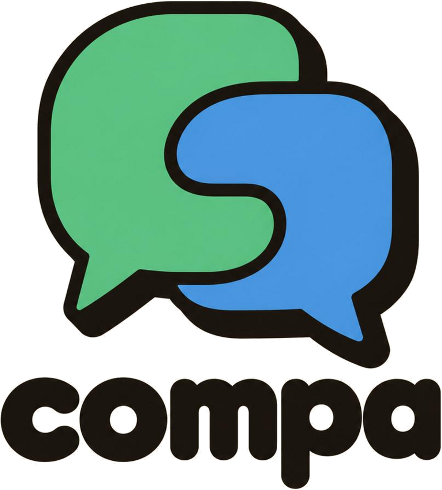

# COMPA

**Turn the conference hallway into data. / Convierte el pasillo del evento en conexiones.**

Scan a QR, meet someone, get points, and watch the whole room light up on the big screen.
<br>
*Escanea un QR, conoce a alguien, suma puntos y mira cómo se ilumina toda la sala en la pantalla gigante.*

[**Live demo → compa.lol**](https://compa.lol) · [Demo video](#demo-video) · [Built with Codex](#built-with-codex) · [Run it locally](#run-it-locally)

    

</div>

<p align="center">
  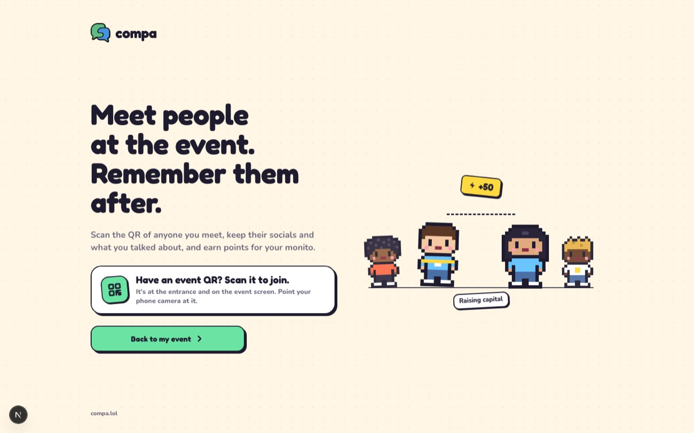
</p>

---

## The problem

At a conference you meet dozens of people in a day and forget most of them: who they were, what you talked about, whether you ever followed up. Organizers have the opposite problem: they know how many tickets they sold but not who actually connected, or what their community talks about in the hallway.

## The solution

COMPA is a networking companion for live events. An attendee signs in with LinkedIn (or an email magic link), joins an event by scanning its QR, and from then on connecting is **two taps**: show your QR or scan someone else's. Each connection earns points for both people, an optional **voice note** is turned into a short AI summary of the conversation, and everything shows up in real time on a **Kahoot-style big screen** with the leaderboard and an animated map of who is meeting whom.

- **For attendees:** a memory of who you met, a reason to say hello, and a game on top.
- **For organizers:** a live view of the room, a super-admin console, and an animated QR poster to put on the wall.

## Features

| | |
| --- | --- |
| **LinkedIn sign-in, QR-gated events** | Sign in with LinkedIn OIDC or an email magic link; join an event with its QR or access code and consent to check-in. |
| **Scan-to-connect** | Show your personal QR or scan another one. Connections and points are idempotent, so double scans never double count. |
| **Points, ranking and badges** | Points for new connections, reconnections and summaries; a live ranking; collectible badges and a golden cap for inviting friends. |
| **AI voice summaries** | Dictate a note after a conversation; the server transcribes it and drafts a structured summary both people approve before it is shared. |
| **Incoming requests and notifications** | A live bell fed by private Realtime channels, plus Web Push for when the app is closed. |
| **Live big screen** | `/e/<code>/live` shows counters, the top connectors and an animated network of people and topics, built for a 1920×1080 projector. |
| **Super-admin console** | Create and archive events, manage organizers and attendees, rotate access codes, create test users. |
| **Animated QR poster** | A printable, animated QR so a whole room can join in seconds. |
| **Bilingual and responsive** | Spanish and English (`es*` locale → Spanish), designed mobile-first at 390, tablet 834 and desktop 1440. |

### Screens

<table>
  <tr>
    <td align="center">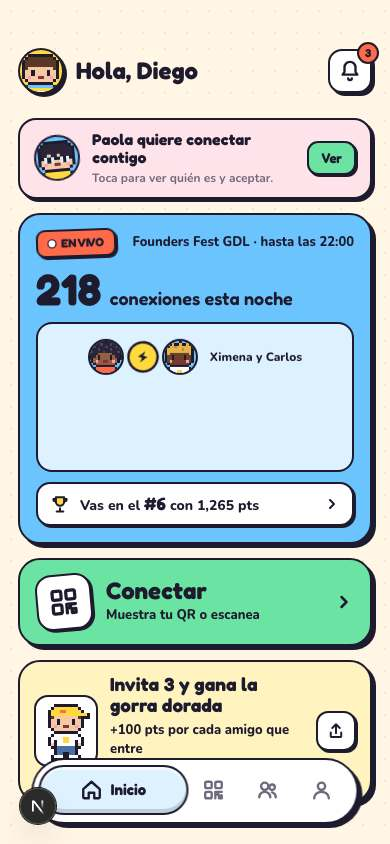<br><sub>Home: requests, live count, rank</sub></td>
    <td align="center">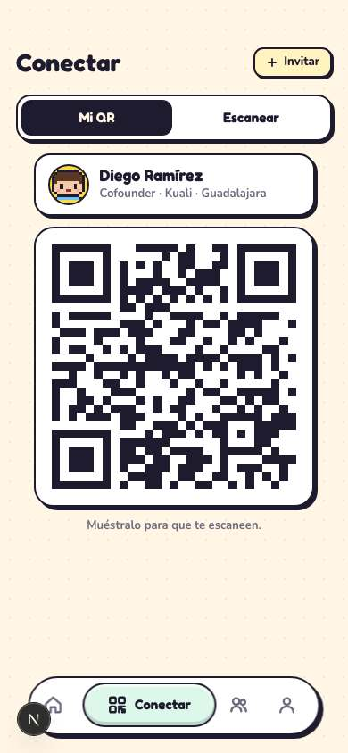<br><sub>Connect: show or scan a QR</sub></td>
    <td align="center">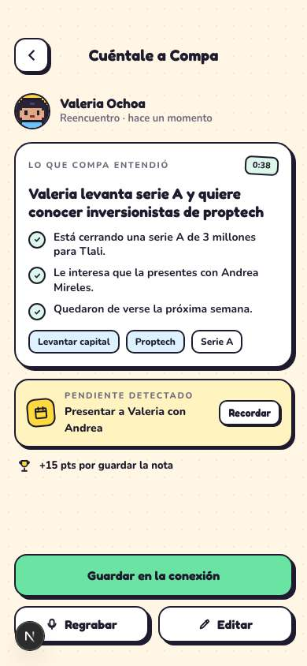<br><sub>Voice note and AI summary</sub></td>
  </tr>
  <tr>
    <td align="center">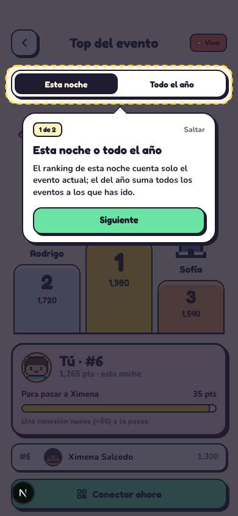<br><sub>Ranking</sub></td>
    <td align="center">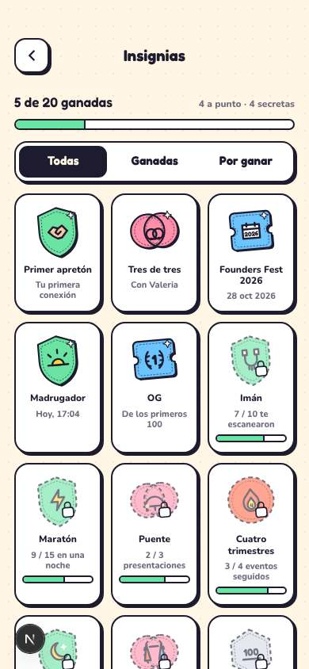<br><sub>Badges</sub></td>
    <td align="center">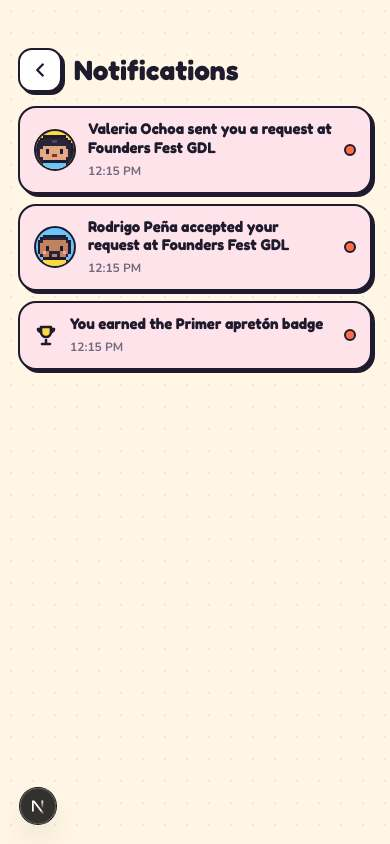<br><sub>Notifications</sub></td>
  </tr>
</table>

<p align="center">
  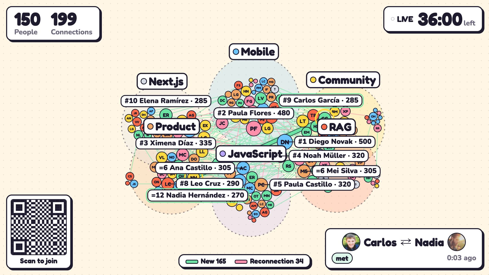<br>
  <sub>The big screen: people, connections, topics and the top connectors, with a QR to join (design prototype with simulated data, see <a href="docs/research/live-dataviz.md">live dataviz research</a>).</sub>
</p>

<p align="center">
  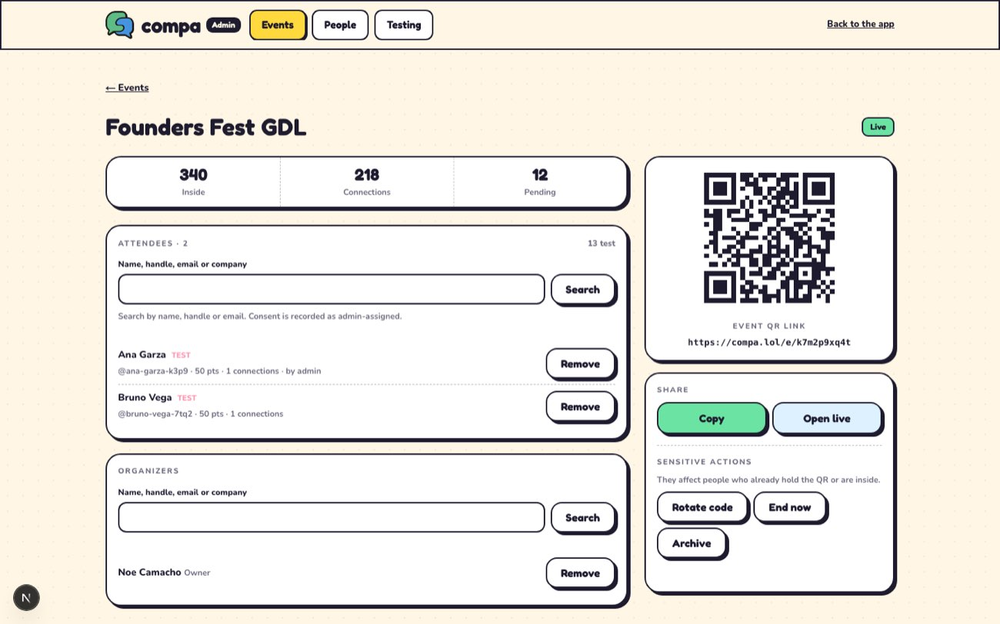<br>
  <sub>Super-admin console: event details, access code, organizers and attendees.</sub>
</p>

## How it works

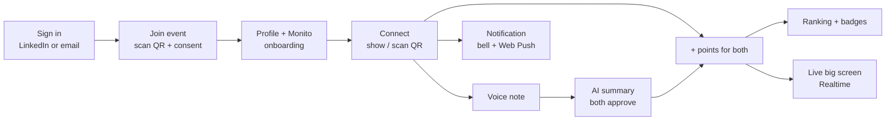

## Architecture and stack

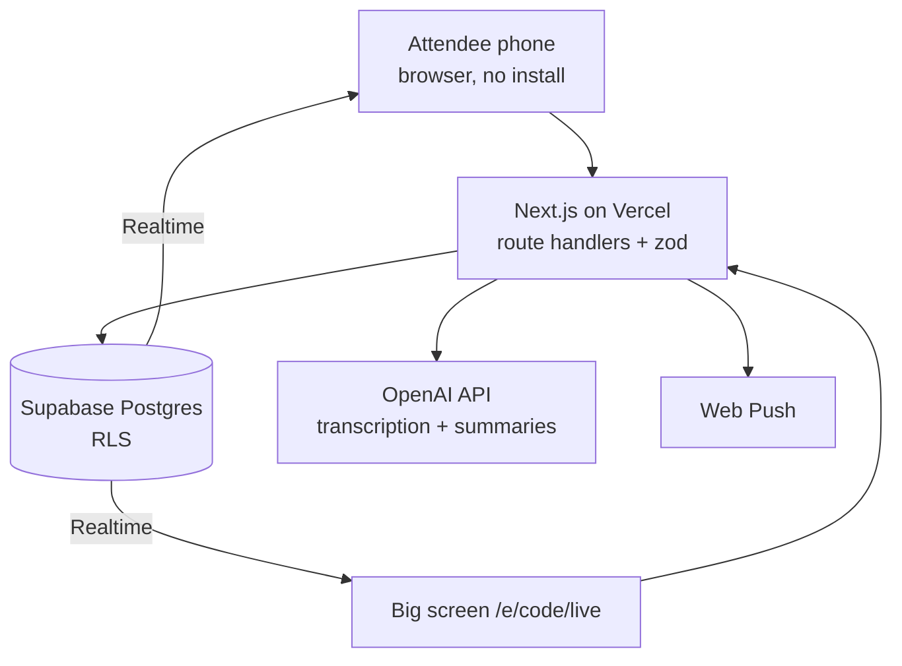

| Layer | Choice |
| --- | --- |
| App and API | Next.js 16 (App Router), React 19, strict TypeScript, Tailwind CSS 4 |
| Runtime and packages | Bun |
| Data and realtime | Supabase (Postgres, Auth, Realtime) with Drizzle ORM migrations |
| AI | OpenAI API (speech-to-text and structured summaries), only called from the server |
| Validation | zod at every boundary; OpenAPI spec generated from the schemas (`/api/docs`) |
| Visuals | three.js for the live network, `qrcode` and `jsqr` for QR generation and scanning |
| Hosting | Vercel, domain [compa.lol](https://compa.lol) |

More: [ARCHITECTURE.md](ARCHITECTURE.md), [DESIGN.md](DESIGN.md), [wiki/architecture-stack.md](wiki/architecture-stack.md), [wiki/conference-scale.md](wiki/conference-scale.md).

## What was built here (Codex Build Day, Guadalajara)

Everything in this repository was built for the event, starting 2026-10-28 (see the [git history](../../commits/main)). No pre-existing project was reused.

**Built and working**

- LinkedIn and email sign-in, event door, consented check-in, profile and Monito onboarding
- QR connections, incoming requests (accept / decline), idempotent points, ranking, badges, invites
- Voice transcription and AI conversation summaries with approval
- Live notifications (Realtime) and Web Push
- Live big screen, super-admin console, animated QR poster, test users and a seeded demo mode
- Full OpenAPI reference, Playwright e2e specs, unit tests, bilingual UI

**Not built or still open**

- Organizer "ask your event" analyst (stretch goal) and recording with the other person's consent are out of the MVP cut order ([wiki/mvp-scope.md](wiki/mvp-scope.md))
- Open product questions and known gaps are tracked in [wiki/open-questions.md](wiki/open-questions.md)

**Reused, with licenses**: open-source dependencies listed in [package.json](package.json) under their own licenses (MIT/Apache-2.0 class); pixel-art avatar and UI style are original to this project.

## Demo video

> The demo video is added here before submission: _link pending_ (see [docs/evidence/codex/](docs/evidence/codex/)).

Suggested walkthrough (3 minutes, [wiki/demo-script.md](wiki/demo-script.md)): sign in → join the event by QR → connect with the person next to you → dictate and approve a summary → watch the points land on the big screen.

**Try it yourself:** open [compa.lol](https://compa.lol) on two phones (or two browsers), join the same event, and scan each other's QR from the **Connect** tab. Test users and demo events are described in [docs/testing/real-mode.md](docs/testing/real-mode.md).

## Built with Codex

COMPA was built with coding agents working in parallel: Codex and Claude Code, each in its own git worktree and branch, following a single contract, [AGENTS.md](AGENTS.md), and a project knowledge base, the [wiki](wiki/index.md).

How Codex was used:

- **Parallel threads in worktrees**: one lane per area (profile and QR, connections and points, summaries, live and seeds), merged through small reviewed PRs ([wiki/team-and-prs.md](wiki/team-and-prs.md)).
- **`AGENTS.md` as the contract**: coding standards, product rules, git rules and the PR template are enforced by hooks ([docs/agent-tooling.md](docs/agent-tooling.md), [docs/git-workflow.md](docs/git-workflow.md)); Codex hooks live in [.codex/hooks.json](.codex/hooks.json).
- **Review and tests**: every change was reviewed by another agent or person and verified with unit tests, Playwright specs and type/lint checks before merge.
- **Marketing videos and evidence**: produced with Codex.

### Evidence of Codex use

Evidence (screenshots without sensitive data and short video segments) lives in [`docs/evidence/codex/`](docs/evidence/codex/).

<!-- EVIDENCE-LIST: the evidence PR fills this list. One line per item: what task, where Codex was used, how the result was reviewed or tested. -->

| Item | Task done with Codex | How it was reviewed or tested |
| --- | --- | --- |
| _pending_ | _filled by the evidence PR_ | _filled by the evidence PR_ |

## Team

| Name | GitHub |
| --- | --- |
| Noe Camacho | [@noecamacho](https://github.com/noecamacho) |
| Sebastian Gandoulf Perez | [@Gandoulf7](https://github.com/Gandoulf7) |
| Iker Pindter | [@ikerpindter](https://github.com/ikerpindter) |

## Run it locally

Requirements: [Bun](https://bun.sh) (package manager and runtime).

```sh
bun install --frozen-lockfile
cp -n .env.example .env.local
```

For a zero-credential run, set `API_MODE=mock` in `.env.local`, then:

```sh
bun run dev
```

Open <http://localhost:3000> for the app and <http://localhost:3000/api/docs> for the API reference. Mock requests and real-backend setup: [docs/api-quickstart.md](docs/api-quickstart.md).

### Environment variables

Names only; never commit values. Copy [.env.example](.env.example) to `.env.local`.

| Variable | Purpose |
| --- | --- |
| `API_MODE` | `mock` runs without Supabase or OpenAI |
| `DATABASE_URL` | Postgres connection (Supabase) |
| `NEXT_PUBLIC_SUPABASE_URL`, `NEXT_PUBLIC_SUPABASE_ANON_KEY` | Supabase client |
| `SUPABASE_SERVICE_ROLE_KEY` | Server-only Supabase admin access |
| `NEXT_PUBLIC_SITE_URL` | Public site origin |
| `OPENAI_API_KEY`, `OPENAI_STT_MODEL`, `OPENAI_TEXT_MODEL` | Transcription and summaries |
| `NEXT_PUBLIC_VAPID_PUBLIC_KEY`, `VAPID_PRIVATE_KEY`, `VAPID_SUBJECT`, `PUSH_ALLOWED_ORIGINS` | Web Push |
| `SEED_DEMO`, `SEED_ADMIN_HANDLE`, `SEED_TEST_EVENT` | Demo and test seeding |
| `TEST_AUTOMATION_SECRET` | Test-user automation |

For hosted Supabase, configure custom SMTP or a Send Email hook before enabling email sign-in for attendees ([guide](https://supabase.com/docs/guides/auth/auth-smtp)).

## Testing

```sh
bun run lint && bun run typecheck   # static checks
bun test                            # unit tests
bun run e2e:install && bun run e2e  # Playwright (390, 834, 1440 viewports; es and en)
bun run build                       # production build
```

Flows and scenarios: [docs/flows/catalog.md](docs/flows/catalog.md). Testing against a real database with test users (no LinkedIn needed): [docs/testing/real-mode.md](docs/testing/real-mode.md).

## Deployment

Vercel hosts the app at [compa.lol](https://compa.lol). Every push to `main` runs `bun run db:migrate:deploy` (Drizzle migrations against `DATABASE_URL_DIRECT`) before the build, so migrations are additive and backward-compatible. Health check: `/api/health`. Runbook: [wiki/event-day-runbook.md](wiki/event-day-runbook.md).

## Project knowledge

- Start with [AGENTS.md](AGENTS.md), the single instruction file for agents and contributors.
- Knowledge lives in the wiki: [wiki/index.md](wiki/index.md). Hackathon rules: [wiki/hackathon-requirements.md](wiki/hackathon-requirements.md).
- History: [CHANGELOG.md](CHANGELOG.md).

## License

[MIT](LICENSE). The repository contains no secrets; demo data is fictional.
