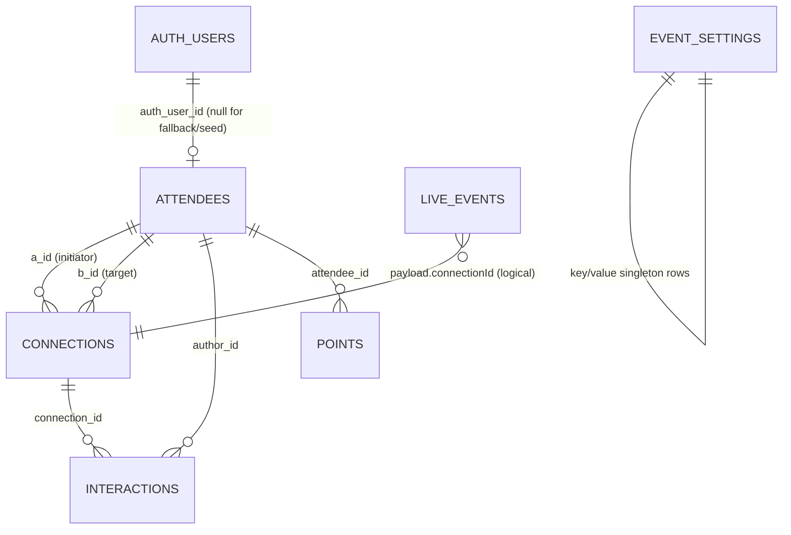

# COMPA MVP API plan — LinkedIn sign-up, visible-by-choice profiles, connections, points, /live feed

Ticket: `COMPA-<TBD>` · Date: 2026-10-28 ~00:00 (night before the 2026-10-29 10:00 submission; feature freeze 09:00) · Status: draft for captain review · Team: 3 people (L = lead/backend, U = UI, I = AI + live data).

This plan reconciles the captain's request ("sign up with LinkedIn, import their profile, choose what to display, track connections, feed the viz") with the repository's binding rules (`AGENTS.md` §4, `ARCHITECTURE.md`, `wiki/*`). Existing facts cite plan pages (`p. N`) or wiki pages; external facts cite URLs in §3 and are marked verified or assumption.

## 1. Summary

- **Auth**: Supabase Auth with the `linkedin_oidc` provider behind a feature flag; the plan's handle + 3-char code flow (p. 4–5) stays as the always-working fallback. One server helper resolves the session for both flows.
- **Import reality**: LinkedIn's self-serve OIDC product returns only name, given/family name, picture, email, email_verified, locale — no headline, positions, or skills (partner-only). "Import from LinkedIn" = name + photo + email, raw claims snapshotted; everything else is entered manually or via the existing "Dictate my profile" AI prefill (wiki/ai-jobs.md).
- **Visibility**: a `field_visibility jsonb` column on `attendees`; one server-only filter `toPublicCard()` applied everywhere a profile leaves the server. Email is never displayed anywhere.
- **Connections**: the plan's 4-table model kept, extended; `a_id` = initiator, `b_id` = target; ordered-pair unique index keeps idempotency (p. 9–10); `is_bridge` stored at write time; points stay a ledger with `unique (attendee_id, reason, ref_id)` (p. 10).
- **/live feed**: one `GET /api/live` snapshot shaped for the three viz prototypes (El Telar / Cae la Ficha / La Piñata) plus one sanitized Realtime table `live_events` — the only table broadcast to the room. Never summary text; anonymous attendees appear as "Anonymous" (p. 13).
- **Tonight**: 3 lanes, scaffold first, LinkedIn go/no-go checkpoint at 03:30; if it slips, flip the flag and ship fallback-only with zero rework.

## 2. Decisions table

| # | Decision | State | Detail / consequence |
| --- | --- | --- | --- |
| D1 | **LinkedIn sign-up replaces "no login or OAuth"** | **Captain decided (2026-10-28, verbal)** — reverses ADR-007 and AGENTS.md §4; plan p. 3 listed OAuth as out of scope | Record here now; follow-up PR must update `AGENTS.md` §4, `ARCHITECTURE.md` ADR-007 (superseded by ADR-010), `wiki/mvp-scope.md`, `wiki/agent-contract.md`. The 2-tap / 60-second onboarding metric (wiki/success-metrics.md, p. 2) still binds: LinkedIn flow is tap "Sign in with LinkedIn" → consent → review screen → done |
| D2 | Handle + code fallback stays, behind flag `NEXT_PUBLIC_AUTH_LINKEDIN` | Decided (this plan) | If the LinkedIn app is not working by 03:30, flag off; demo still meets p. 4–5 flow. No extra work: fallback is the plan's original P0 |
| D3 | Imported LinkedIn fields = `name`, `given_name`, `family_name`, `picture`, `email`, `email_verified`, `locale` only | Decided by platform reality (§3) | Headline/company/role/topics are user-entered (or AI-prefilled via dictation). The UI must not promise a fuller import |
| D4 | Visibility model: `field_visibility jsonb` on `attendees`, key per field, default visible | Decided (this plan; justification §5.2) | One column, one UPDATE, no joins; enforced in exactly one server function |
| D5 | `email` is auth-only: stored, never in any card, any list, or /live | Decided (this plan; extends p. 13 privacy rules) | Not even a visibility toggle; removes the riskiest leak |
| D6 | /live shows names (or "Anonymous"), photos, points, tribes, aggregated topics, counters; never summary text | Decided (p. 13, wiki/privacy-consent.md) | Enforced by building /live only from safe projections + `live_events` |
| D7 | Anonymous opt-out = `attendees.anonymous boolean`; consent = `consent_accepted_at timestamptz` | Decided (this plan) — resolves open question #7 | /join and the review screen set them |
| D8 | +10 goes to **both** parties of a connection | **Needs captain** (open question #8); this plan assumes both | Matches "Connected with Ana · +10" on both screens (p. 5, p. 18) |
| D9 | Connections beyond the 12/hour cap are still created and shown on /live, just unscored | **Needs captain** (open question #9); assumed here | Keeps the room graph honest; cap only fights podium spam (p. 7, p. 20) |
| D10 | One **approved** summary per connection (first approval wins); drafts unlimited | **Needs captain** (open question #10); assumed here | Partial unique index enforces it; prevents double +25 |
| D11 | Seed toggle = `event_settings` row flipped by an admin endpoint guarded by `ADMIN_TOKEN` env | Decided (this plan) — resolves open question #17 | No admin UI needed tonight; `curl` or a bookmarklet |
| D12 | "Active people" counter = attendees with a connection or points row in the last 30 min | Assumption — resolves open question #13 for the MVP | Cheap query; captain may redefine later |
| D13 | LinkedIn `picture` is **copied to Supabase Storage at import** (public `avatars` bucket), not hotlinked | Decided (this plan) — reports put the signed URL's expiry as low as ~30 min (§3.2), too short even for one day | One fetch + upload in the callback (~20 min of work); on failure fall back to the hotlink and accept R4. Bucket policy → new open question #21 |
| D14 | Product UI language | **Needs captain** (open question #6, unchanged) | Does not block the API; copy lives in dedicated files |
| D15 | Domain for the QR | **Needs captain** (open question #2, unchanged) | Vercel URL works for the demo |

## 3. Hard truths: what LinkedIn actually gives us tonight

All claims in this section verified on the web 2026-10-28 unless marked otherwise.

### 3.1 Sign In with LinkedIn using OpenID Connect (the only self-serve option)

- The current self-serve product is **"Sign In with LinkedIn using OpenID Connect"**. It grants exactly the OAuth scopes `openid`, `profile` (lite profile: id, name, picture), `email`, and exposes `GET https://api.linkedin.com/v2/userinfo`. Claims: `sub`, `name`, `given_name`, `family_name`, `picture`, `locale`, plus `email` and `email_verified` — the docs explicitly warn email claims "may not be included in all responses", so the callback must tolerate a missing email (UC-01). Source: https://learn.microsoft.com/en-us/linkedin/consumer/integrations/self-serve/sign-in-with-linkedin-v2 (claims also in `https://www.linkedin.com/oauth/.well-known/openid-configuration` → `claims_supported`).
- **Not available** without a LinkedIn partner program: headline, positions/work history, skills, education, vanity URL, connections. Only the "Open Permissions" (Sign In with OIDC; Share on LinkedIn) are self-service; the Profile API (`r_basicprofile`, `GET /v2/me`) is "restricted to those developers approved by LinkedIn", and richer access goes through partner programs (Marketing Developer Platform, Sales Navigator, Talent, Learning, Compliance). The legacy "Sign In with LinkedIn" (`r_liteprofile`/`r_emailaddress`) was deprecated 2023-08-01; new apps cannot get those scopes (hard shutdown date for old apps: unverified). Sources: https://learn.microsoft.com/en-us/linkedin/shared/authentication/getting-access · https://learn.microsoft.com/en-us/linkedin/shared/integrations/people/profile-api · https://learn.microsoft.com/en-us/linkedin/consumer/integrations/self-serve/sign-in-with-linkedin. (One LinkedIn page claims the OIDC `profile` permission includes "headline"; the userinfo schema has no headline field — treat headline as NOT returned.)
- **Consequence**: "import the data from their LinkedIn profile" can only honestly mean **name + photo + verified email**. The plan's profile fields (headline/company/role/tribe/topics/seeking/offering/links, wiki/screens/join.md, p. 4–5) are completed by the user on the review screen, optionally AI-prefilled by "Dictate my profile" (wiki/ai-jobs.md, p. 11). A pasted LinkedIn profile URL is stored as `links.linkedin` only — scraping it violates LinkedIn's terms and is not attempted.

### 3.2 Supabase Auth LinkedIn provider

- Supabase Auth ships a built-in **LinkedIn (OIDC)** provider, id **`linkedin_oidc`** (the old `linkedin` provider is deprecated; removal was slated 2024-01-04). Configuration: LinkedIn client ID + secret in Dashboard → Authentication → Sign In/Providers → LinkedIn (OIDC); redirect URL to register on the LinkedIn app is `https://<project-ref>.supabase.co/auth/v1/callback` (local: `http://localhost:54321/auth/v1/callback`). Supabase requests scopes `openid email profile` (confirmed in the auth server source). Sources: https://supabase.com/docs/guides/auth/social-login/auth-linkedin · https://raw.githubusercontent.com/supabase/auth/master/internal/api/provider/linkedin_oidc.go
- `supabase-js` supports `signInWithOAuth({ provider: 'linkedin_oidc' })`; the server-side PKCE flow with `@supabase/ssr` (`exchangeCodeForSession` in a callback route handler, `redirectTo` in the allow list) is documented with a Next.js App Router example on the same page. Also: https://supabase.com/docs/guides/auth/server-side/nextjs
- Supabase's provider **parses the ID token** rather than calling userinfo, so `auth.users.raw_user_meta_data` and `identities[].identity_data` carry the ID-token claims (expect sub, name, given_name, family_name, picture, email, email_verified). [Exact metadata key names/aliases unverified — confirm against the first live sign-in; the callback snapshots whatever arrives into `attendees.linkedin_raw` so nothing is lost.]
- Gotchas: standard OIDC apps get a 60-day LinkedIn access token and **no provider refresh token** (partner-only: https://learn.microsoft.com/en-us/linkedin/shared/authentication/programmatic-refresh-tokens) — irrelevant for our one-time import; Supabase's own session refresh is unaffected. The `picture` claim is a time-limited signed `media.licdn.com` URL — third-party reports put expiry as low as ~30 minutes (official TTL unverified; e.g. https://nubela.co/blog/why-is-the-api-returning-s3-links-for-profile-pictures-scraped-from-linkedin-profiles), so hotlinking is unsafe even for one day → D13 copies the image at import.

### 3.3 LinkedIn developer app setup — steps and time risk

1. Create the app at https://www.linkedin.com/developers/apps (requires a LinkedIn account, a logo, and **association with a LinkedIn company Page** — a freshly created Page works).
2. App verification: the Settings tab's "Verify" button generates a URL a Page **super admin** must approve (they have up to 30 days; for us the admin is on the team, so minutes — but verified status can gate product activation). Sources: https://www.linkedin.com/help/learning/answer/a1665329 · https://www.linkedin.com/help/learning/answer/a1669245 (help articles are dated; menu labels may drift).
3. Add the product "Sign In with LinkedIn using OpenID Connect" — "available to all developers without special approval" (getting-access URL above), normally instant.
4. Under the Auth tab, add the redirect URL `https://<project-ref>.supabase.co/auth/v1/callback`; copy client ID/secret into Supabase.
5. Supabase: enable LinkedIn (OIDC); set Site URL + additional redirect URLs for the Vercel domain and localhost.

Time risk: usually < 30 min end to end when the Page admin is in the room, but verification/product activation can stall unpredictably. That is exactly why flag D2 exists, and why this is the **first** task tonight, not the last. [Timing beyond the documented steps is an experience-based assumption.]

## 4. Use cases

Conventions: "session" = resolved attendee via `getSessionAttendee()` (§6.1). All writes zod-validated (AGENTS.md §4). AC = acceptance criteria.

| UC | Name / actor / trigger | Main flow | Alternates / errors | AC |
| --- | --- | --- | --- | --- |
| UC-01 | **Sign up with LinkedIn** — visitor taps "Continue with LinkedIn" on `/join` (flag on) | `signInWithOAuth(linkedin_oidc)` → LinkedIn consent → Supabase callback → app `GET /auth/callback` exchanges code, upserts attendee from claims (name, photo, email, `linkedin_raw`), generates handle+code, sets session → redirect `/onboarding/review` | LinkedIn denies/cancel → back to `/join` with fallback form. Claims missing email → attendee created without email. Existing `auth_user_id` → straight to `/me` | New user lands on review screen < 60 s from first tap (p. 2); re-login reuses the same attendee; no duplicate attendee per LinkedIn account |
| UC-02 | **Fallback sign-up** — visitor fills the `/join` form (always available; only path when flag off) | `POST /api/attendees` → validate, normalize links (p. 4), generate unique handle + 3-char code, set cookie → `/me` | Name missing → 400. Duplicate handle → numeric suffix (p. 5) | Works with only name filled (p. 5); handle+code recover the session elsewhere (p. 5) |
| UC-03 | **Review imported data and choose visible fields** — new LinkedIn user, after UC-01 | Review screen shows imported name/photo/email (email labeled "never shown to others"), editable profile fields, a visibility toggle per field (default on), consent checkbox, anonymous checkbox → `PATCH /api/me` + `PATCH /api/me/visibility` | Skip = defaults (all visible, not anonymous) after consent. No consent → cannot proceed (p. 13) | Toggled-off field never appears in any card or search result; email never appears regardless |
| UC-04 | **Edit profile** — attendee on `/me/edit` | `GET /api/me` → edit → `PATCH /api/me` | Invalid topic/tribe → 400 with field errors | Changes visible on next card load; handle immutable tonight |
| UC-05 | **View own QR / handle** — attendee opens `/me` | Server component renders QR of `https://<domain>/c/<handle>`, handle + code below, own counters (made/received/points) | No session → redirect `/join` | QR scans with native iPhone/Android camera (p. 5); loads < 1 s on 4G (p. 5) |
| UC-06 | **Scan someone's QR (with session)** — attendee's camera opens `/c/[handle]` | Page auto-calls `POST /api/connections {targetHandle, method:'qr'}` → redirect `/connection/[id]` showing "+10" | Own QR → message, no connection (p. 5). Repeat scan → same connection id, no new points (p. 5). Target not found → 404 page | Double scan never duplicates (p. 9–10); both parties see the card < 2 s (p. 5) |
| UC-07 | **Scan someone's QR (no session)** — visitor opens `/c/[handle]` | Inviter's public card above the short join form (p. 5) → UC-01 or UC-02 inline → connection auto-created on save → `/connection/[id]` | Same errors as UC-01/02 | New visitor is connected in one save (p. 4–5) |
| UC-08 | **Connect by @tag (P1)** — attendee types in `/me` search | `GET /api/attendees/search?q=` autocomplete → pick → `POST /api/connections {method:'tag'}` | No match → empty state | Cut third per p. 3 order; same idempotency as QR |
| UC-09 | **View connection card** — attendee opens `/connection/[id]` | `GET /api/connections/:id` → other party's public card (visibility-filtered), "Follow on…" buttons from visible `links` only, points earned, Record/Summarize actions (p. 5) | Not a member of the connection → 404 (not 403, avoids existence leak) | Hidden fields absent from payload, not blanked client-side |
| UC-10 | **List my connections** — attendee opens `/connections` | `GET /api/connections` → made + received with cards and summary status, pending summaries first (p. 6) | Empty → empty state with QR hint | Counts shown: made, received, total, bridges (§8.4) |
| UC-11 | **Summary: write/dictate → draft → approve** — attendee on `/connection/[id]/summary` | (optional) `POST /api/transcribe` audio→text → `POST /api/interactions/draft` → editable `{summary, topics, next_steps}` → `POST /api/interactions/:id/approve` → +25 each, shared with both, live event (p. 6, p. 18) | Transcribe fails → text field (p. 12). Draft fails → verbatim text as summary (p. 12). `substantive=false` → approve blocked (p. 11). Second approval on same connection → 409 (D10) | Only the author approves; both see it after approval; approving twice never double-awards (p. 10) |
| UC-12 | **Points awarded** — system, on connection create / approve | Ledger inserts per §8.3: +10 both, +15 bridge both, +5 first-of-day, cap 12 scoring connections/h (p. 7) | Past cap → connection exists, no points (D9). Conflict on `(attendee_id, reason, ref_id)` → silently once (p. 10) | Replays and double taps never change totals |
| UC-13 | **/live snapshot + realtime** — projected screen loads `/live` | `GET /api/live` snapshot → subscribe to `live_events` inserts → update podium/topics/counters/feed, refetch snapshot (1 s debounce) on event | Realtime drops → poll snapshot every 10 s | Update visible < 2 s after a write (p. 2); never summary text; anonymous shown as "Anonymous" (p. 13) |
| UC-14 | **Organizer seed toggle** — organizer, before the public demo | `POST /api/admin/settings {showSeeds:false}` with `x-admin-token` → `/api/live` excludes seeds, live event emitted so the screen refetches | Bad token → 401 | Seeds vanish from /live without redeploy (p. 13, p. 18) |
| UC-15 | **Session recovery / sign out** — attendee on a new browser | `/recover`: `POST /api/session/recover {handle, code}` → cookie set. Sign out: `POST /api/auth/signout` clears Supabase session + cookie | Wrong pair → 401 generic message | Handle+code works regardless of sign-up method (p. 5, p. 20) |
| UC-16 | **Delete / anonymize my data** — attendee in settings | `DELETE /api/me` → profile fields nulled, `name='Deleted'`, `anonymous=true`, `deleted_at` set, email + `linkedin_raw` erased, Supabase auth user deleted, session cleared. Connections/points rows stay (graph integrity) | — | Card and /live show no personal data afterwards; counters stay consistent |

## 5. Database entities (Supabase Postgres)

Extends wiki/data-model.md (p. 9–10); the migration remains the lead-owned contract `supabase/migrations/0001_init.sql` (p. 14, p. 17).

### 5.1 ER diagram



### 5.2 Tables (SQL)

```sql
-- attendees: plan table (p. 9) + auth link, import snapshot, visibility, consent
create table attendees (
  id                   uuid primary key default gen_random_uuid(),
  auth_user_id         uuid unique references auth.users (id) on delete set null,
  handle               text not null unique,
  code                 text not null,                 -- 3-char recovery code (p. 4)
  name                 text not null,
  email                text,                          -- OIDC import; never displayed (D5)
  photo_url            text,
  headline             text,                          -- user-entered (LinkedIn won't give it, §3.1)
  company              text,
  role                 text,
  tribe                text check (tribe in ('frontend','backend','ai','design','other')),
  topics               text[] not null default '{}',  -- enforced against lib/topics.ts in zod
  seeking              text,
  offering             text,
  links                jsonb not null default '{}',   -- {linkedin, github, x, instagram, facebook, tiktok, web}
  field_visibility     jsonb not null default '{}',   -- {"company": false, ...}; missing key = visible (D4)
  anonymous            boolean not null default false, -- leaderboard opt-out (p. 13, resolves OQ #7)
  consent_accepted_at  timestamptz,                   -- /join notice acceptance (p. 13, resolves OQ #7)
  linkedin_raw         jsonb,                         -- userinfo claims snapshot
  linkedin_imported_at timestamptz,
  is_seed              boolean not null default false,
  deleted_at           timestamptz,
  created_at           timestamptz not null default now()
);

-- connections: a_id is ALWAYS the initiator (scanner / @tag sender), b_id the target.
create table connections (
  id            uuid primary key default gen_random_uuid(),
  a_id          uuid not null references attendees (id),
  b_id          uuid not null references attendees (id),
  method        text not null check (method in ('qr','tag','seed')),
  is_bridge     boolean not null default false,       -- tribes differ and both set (p. 7)
  shared_topics text[] not null default '{}',
  created_at    timestamptz not null default now(),
  check (a_id <> b_id)
);
-- A->B and B->A are one connection (p. 9-10); keeps idempotency with direction kept in a_id/b_id
create unique index connections_pair_uq
  on connections (least(a_id, b_id), greatest(a_id, b_id));
create index connections_a_idx on connections (a_id);
create index connections_b_idx on connections (b_id);

create table interactions (
  id            uuid primary key default gen_random_uuid(),
  connection_id uuid not null references connections (id),
  author_id     uuid not null references attendees (id),
  recorded      boolean not null default false,
  consent_ok    boolean not null default false,
  transcript    text,
  summary       text,
  topics        text[] not null default '{}',
  next_steps    text[] not null default '{}',
  substantive   boolean not null default false,
  approved_at   timestamptz,
  created_at    timestamptz not null default now()
);
create index interactions_connection_idx on interactions (connection_id);
-- one APPROVED summary per connection (D10); drafts unlimited
create unique index interactions_one_approved_uq
  on interactions (connection_id) where approved_at is not null;

create table points (
  id          bigint generated always as identity primary key,
  attendee_id uuid not null references attendees (id),
  reason      text not null check (reason in ('connection','bridge','summary','first_of_day')),
  amount      int  not null,
  round       int  not null default 1,
  ref_id      uuid not null,                           -- connection or interaction id (p. 10)
  created_at  timestamptz not null default now(),
  unique (attendee_id, reason, ref_id)                 -- idempotency (p. 10)
);
create index points_attendee_idx on points (attendee_id, reason, created_at); -- cap + totals
-- first_of_day truly once per person per event day (guards the race)
create unique index points_first_of_day_uq
  on points (attendee_id, ((created_at at time zone 'America/Mexico_City')::date))
  where reason = 'first_of_day';

-- live_events: the ONLY table the room subscribes to. Server-written, pre-sanitized (§9.2).
create table live_events (
  id         bigint generated always as identity primary key,
  type       text not null check (type in ('connection','summary','points','settings')),
  payload    jsonb not null,                           -- no email, no summary text, anonymity applied
  created_at timestamptz not null default now()
);

create table event_settings (
  key   text primary key,                              -- 'show_seeds'
  value jsonb not null
);
insert into event_settings (key, value) values ('show_seeds', 'true');
```

### 5.3 Visibility model — why jsonb over a `profile_fields` table

| Option | Verdict |
| --- | --- |
| `profile_fields` rows (`attendee_id, field, visible`) | Relationally cleaner, supports per-field audit — but needs a join or second query on every card read, an upsert loop on save, and more RLS surface. Overkill for 9 fixed fields on a one-night build |
| **`field_visibility jsonb` (chosen, D4)** | One column; one `UPDATE`; zod whitelists keys (`photo, headline, company, role, tribe, topics, seeking, offering, links`); missing key = visible. The entire rule lives in one function (§7.1) |

`name` and `handle` are always visible on cards (the product is useless without them, p. 5); `anonymous` governs /live only (p. 13); `email` has no toggle because it is never shown (D5).

### 5.4 RLS stance and Realtime exposure

- **RLS enabled on every table.** No policies for `anon`/`authenticated` on `attendees`, `connections`, `interactions`, `points`, `event_settings` — all reads and writes go through route handlers using the service-role key (server-only, ADR-006, p. 11, p. 17).
- **One exception**: `live_events` gets `create policy live_events_read on live_events for select to anon using (true);` and is the only table added to the `supabase_realtime` publication. Postgres-changes payloads therefore only ever carry pre-sanitized rows. This is how "which columns are safe to broadcast" is answered structurally: columns of `live_events` only, and its `payload` is constructed server-side to exclude email, summary text, hidden fields, and real names of anonymous attendees.

## 6. Auth design

### 6.1 One session resolver for both flows

```ts
// lib/session.ts (server only)
// 1) Supabase auth session (PKCE cookie via @supabase/ssr) -> attendees.auth_user_id
// 2) else COMPA cookie `compa_session` (httpOnly, signed attendee id) -> attendees.id
// returns Attendee | null; every route handler calls this and nothing else
export async function getSessionAttendee(): Promise<Attendee | null>;
```

The fallback cookie is set by `POST /api/attendees` and `POST /api/session/recover` (p. 4–5, p. 10). The LinkedIn callback also sets it, so one mechanism suffices after login if Supabase cookies misbehave on iOS Safari.

### 6.2 LinkedIn flow (flag on)

1. `/join` renders "Continue with LinkedIn" when `NEXT_PUBLIC_AUTH_LINKEDIN=1`, plus the classic form below it.
2. Client calls `supabase.auth.signInWithOAuth({ provider: 'linkedin_oidc', options: { redirectTo: '<site>/auth/callback' } })` (§3.2).
3. `GET /auth/callback` (route handler): `exchangeCodeForSession(code)` → read user → upsert attendee by `auth_user_id`:
   - new: `name` ← claim `name`, `photo_url` ← `picture` downloaded and re-uploaded to the `avatars` Storage bucket (D13; hotlink fallback on failure), `email` ← `email` (may be absent, §3.1), `linkedin_raw` ← full claims, `linkedin_imported_at = now()`, handle ← slug of `given_name` (+ numeric suffix on collision, p. 5), code ← 3 chars; set `compa_session`; redirect `/onboarding/review`.
   - existing: refresh `linkedin_raw`; redirect `/me`.
4. Review screen (UC-03) completes profile + visibility + consent.

Env: `NEXT_PUBLIC_SUPABASE_URL`, `NEXT_PUBLIC_SUPABASE_ANON_KEY` (client: auth + realtime only), `SUPABASE_SERVICE_ROLE_KEY`, `SESSION_SECRET`, `ADMIN_TOKEN`, `OPENAI_API_KEY`, `OPENAI_STT_MODEL`, `OPENAI_TEXT_MODEL` (p. 12), `NEXT_PUBLIC_AUTH_LINKEDIN`.

## 7. API behavior (route handlers)

Shared zod (in `lib/schemas.ts`, shared client/server per ADR-005):

```ts
import { z } from "zod";
import { TOPICS } from "./topics"; // lib/topics.ts contract file (p. 17; OQ #4)

export const TRIBES = ["frontend", "backend", "ai", "design", "other"] as const;
export const NETWORKS = ["linkedin", "github", "x", "instagram", "facebook", "tiktok", "web"] as const;
export const VISIBILITY_FIELDS = ["photo", "headline", "company", "role", "tribe", "topics", "seeking", "offering", "links"] as const;

export const Handle = z.string().regex(/^[a-z0-9_]{2,24}$/);
export const Links = z.record(z.enum(NETWORKS), z.string().trim().min(1).max(200)); // raw @user or URL; normalized server-side (p. 4)

export const ProfileInput = z.object({
  name: z.string().trim().min(1).max(80),
  photoUrl: z.string().url().max(500).optional(),
  headline: z.string().trim().max(120).optional(),
  company: z.string().trim().max(80).optional(),
  role: z.string().trim().max(80).optional(),
  tribe: z.enum(TRIBES).optional(),
  topics: z.array(z.enum(TOPICS)).max(8).default([]),
  seeking: z.string().trim().max(200).optional(),
  offering: z.string().trim().max(200).optional(),
  links: Links.default({}),
  anonymous: z.boolean().default(false),
  consentAccepted: z.literal(true), // the /join notice (p. 13)
});

export const VisibilityPatch = z.record(z.enum(VISIBILITY_FIELDS), z.boolean());
export const ConnectionInput = z.object({ targetHandle: Handle, method: z.enum(["qr", "tag"]) });
export const RecoverInput = z.object({ handle: Handle, code: z.string().regex(/^[A-Z0-9]{3}$/i) });
export const DraftInput = z.object({ connectionId: z.string().uuid(), text: z.string().trim().min(1).max(4000) });
export const ApproveInput = z.object({
  summary: z.string().trim().min(1).max(1200),
  topics: z.array(z.enum(TOPICS)).max(4),
  nextSteps: z.array(z.string().trim().min(1).max(200)).max(3),
});
export const SettingsInput = z.object({ showSeeds: z.boolean() });
```

### 7.1 The visibility rule — stated once

`lib/visibility.ts` (server only) exports `toPublicCard(attendee): PublicCard`: include `handle`, `name`, then each of `VISIBILITY_FIELDS` only when `field_visibility[field] !== false`; never include `email`, `code`, `auth_user_id`, `linkedin_raw`, `consent_accepted_at`. **Every** payload that describes another person — `GET /api/attendees/:handle`, `/api/attendees/search`, `/api/connections*`, inviter card on `/c/[handle]` — passes through this function. `/api/live` uses the stricter `toLiveActor()` (§9.1). Nothing is filtered client-side.

### 7.2 Routes

| # | Method + path | Auth | Request (zod) | 2xx response | Errors | Idempotency / side effects |
| --- | --- | --- | --- | --- | --- | --- |
| 1 | `GET /auth/callback?code=` | public | query `code` string | 302 → `/onboarding/review` or `/me` | 302 → `/join?error=auth` | Upsert attendee by `auth_user_id` (§6.2); sets cookies. Re-entry safe: upsert |
| 2 | `POST /api/auth/signout` | session | — | 204 | — | Clears Supabase session + `compa_session` |
| 3 | `POST /api/attendees` | public | `ProfileInput` | 201 `{me}` (own full profile + handle + code) | 400 zod | Fallback sign-up; normalizes links, unique handle (+suffix), 3-char code, sets cookie (p. 4–5). Not idempotent by design (each submit = new attendee); UI disables double submit |
| 4 | `POST /api/session/recover` | public | `RecoverInput` | 200 `{me}` | 401 generic ("check handle and code") | Sets cookie. Idempotent |
| 5 | `GET /api/me` | session | — | 200 `{me}`: all own fields incl. `email`, `fieldVisibility`, `anonymous`; never `code` of others | 401 | Read-only |
| 6 | `PATCH /api/me` | session | `ProfileInput.partial().omit({consentAccepted:true})` + optional `consentAccepted: z.literal(true)` | 200 `{me}` | 400, 401 | Idempotent (last-write-wins). Normalizes links |
| 7 | `PATCH /api/me/visibility` | session | `VisibilityPatch` | 200 `{fieldVisibility}` | 400, 401 | Shallow-merges into `field_visibility`. Idempotent |
| 8 | `DELETE /api/me` | session | — | 204 | 401 | UC-16 anonymization; deletes `auth.users` row via admin API. Idempotent |
| 9 | `GET /api/attendees/:handle` | **public** (needed by `/c/[handle]` pre-session, p. 5) | path `Handle` | 200 `{card: PublicCard}` | 404 (also for `deleted_at`) | Read-only; §7.1 filter |
| 10 | `GET /api/attendees/search?q=` (P1) | session | `q: z.string().trim().min(1).max(40)` | 200 `{results: PublicCard[]}` (≤8, excludes seeds + self) | 400, 401 | Read-only; matches handle/name prefix |
| 11 | `POST /api/connections` | session | `ConnectionInput` | 201 `{connection}` / **200** `{connection}` when it already existed | 400; 401; 404 target; 409 `self_connection` | Core idempotent write, §8.2. Side effects: points, `live_events` |
| 12 | `GET /api/connections` | session | query `direction: z.enum(["made","received","all"]).default("all")` | 200 `{items, counts}` — items `{id, direction, card, isBridge, sharedTopics, summaryStatus: 'none'|'draft'|'approved', createdAt}`, pending-summary first (p. 6); counts §8.4 | 401 | Read-only |
| 13 | `GET /api/connections/:id` | session + member | path uuid | 200 `{connection, card, myPoints, summary?}` (`summary` only when approved; draft only to its author) | 401; 404 non-member (UC-09) | Read-only |
| 14 | `POST /api/transcribe` | session | multipart: `audio` file (webm/m4a, ≤ 2 min, ≤ 15 MB — imperative checks; zod for text fields) | 200 `{text}` | 400 bad audio; 401; 502 STT failed → UI falls back to typing (p. 12) | Audio held in memory only, never stored (p. 12, OQ #11 stance) |
| 15 | `POST /api/interactions/draft` | session + member of `connectionId` | `DraftInput` | 201 `{interactionId, summary, topics, nextSteps, substantive}` | 400; 401; 404 non-member; 502 AI failed → client may approve verbatim text (p. 12) | Inserts draft row (`approved_at null`). Multiple drafts allowed; each call = new row. OpenAI Structured Outputs server-side only (ADR-003, p. 12) |
| 16 | `POST /api/interactions/:id/approve` | session; must be the draft's `author_id` and a member | `ApproveInput` (user-edited values) | 200 `{interaction, pointsAwarded}` | 401; 403 not author; 404; 409 `not_substantive` (p. 11) or `already_approved` (self or other draft, D10) | Sets `summary/topics/next_steps/approved_at`; +25 each via ledger (`ref_id` = interaction id, p. 10, p. 18); emits `summary` live event. Replay-safe: second call hits 409 / unique indexes |
| 17 | `GET /api/live` | **public** | query `mock: z.coerce.boolean().optional()` (serves the committed fixture for UI dev) | 200 `LiveSnapshot` (§9.1) | — | Read-only; honors `show_seeds` and anonymity; cache 1 s |
| 18 | `POST /api/admin/settings` | header `x-admin-token === env.ADMIN_TOKEN` | `SettingsInput` | 200 `{showSeeds}` | 401 | Updates `event_settings`, emits `settings` live event (D11) |

Error body everywhere: `{ error: { code: string, message: string, fields? } }`; codes above in backticks. 401 = no/invalid session, 403 = wrong actor, 404 = not found or concealed, 409 = state conflict, 422 unused, 400 = zod.

## 8. Connection tracking — exact semantics

### 8.1 Creation and attribution

`POST /api/connections` with session attendee S and target T (by handle):

1. Guards: T exists and not deleted → else 404; `S.id !== T.id` → else 409 (p. 5).
2. Compute `shared_topics = S.topics ∩ T.topics` (p. 9) and `is_bridge = S.tribe && T.tribe && S.tribe !== T.tribe` (p. 7).
3. `INSERT (a_id = S.id /* initiator */, b_id = T.id, method, is_bridge, shared_topics) ON CONFLICT ((least…,greatest…)) DO NOTHING RETURNING *`; on conflict, select the existing row and return 200 with it — **the same pair is one connection forever** (p. 9–10); attribution (who initiated) stays with the first scan; a later reverse scan returns the existing row and awards nothing.
4. Award points (§8.3) only when the insert actually happened.
5. Insert `live_events` row type `connection` (§9.2).

### 8.2 Dedup matrix

| Event | Result |
| --- | --- |
| S scans T twice | 1 row, points once (pair index + points unique) |
| T then scans S | same row returned, no new row, no new points (`ref_id` = same connection id) |
| Two simultaneous first scans | one insert wins; the loser's `ON CONFLICT DO NOTHING` returns the winner's row |
| Retry after network error | same as repeat scan |

### 8.3 Points writes (all in `lib/points.ts`, server only, p. 11, p. 17)

For a **newly created** connection C between P1 (initiator) and P2, for each participant P:

1. **Cap**: `count(points where attendee_id = P and reason = 'connection' and created_at > now() - interval '1 hour') >= 12` → skip all connection-related awards for P (p. 7); the connection itself stands (D9).
2. `insert (P, 'connection', 10, ref_id = C.id) on conflict do nothing` — both parties (D8).
3. If `C.is_bridge`: `insert (P, 'bridge', 15, ref_id = C.id) on conflict do nothing` (p. 7).
4. `insert (P, 'first_of_day', 5, ref_id = C.id)` guarded by the partial daily unique index; conflict → ignore (p. 7).

On summary approval of interaction I on connection C: `insert (P, 'summary', 25, ref_id = I.id) on conflict do nothing` for both members of C (p. 18). The approve-side 409s plus `interactions_one_approved_uq` make a second +25 impossible (D10).

Totals are always `sum(amount)` over the ledger — no cached counters to drift.

### 8.4 Counts each person sees (`GET /api/connections` → `counts`)

```ts
type ConnectionCounts = {
  made: number;      // connections where a_id = me (I initiated)
  received: number;  // connections where b_id = me (someone scanned me / tagged me)
  total: number;     // made + received (equals my degree in the graph)
  bridges: number;   // rows with is_bridge where I am a member
  points: number;    // sum over my points ledger
};
```

## 9. Data-viz contract (`/live`)

One feed serves all three prototypes (El Telar thread ring, Cae la Ficha pachinko, La Piñata): attendees with tribe/points, connections with bridge flag + shared topics, approved-summary topics, counters, top-5. The UI teammate builds against the committed fixture `fixtures/live-snapshot.json` (same shape) and `GET /api/live?mock=1` tonight, before real data exists.

### 9.1 Snapshot — `GET /api/live` → `LiveSnapshot`

```ts
type LiveActor = {
  id: string;              // attendee uuid (safe: no PII by itself)
  label: string;           // name, or "Anonymous" when attendees.anonymous (p. 13)
  photoUrl: string | null; // null when anonymous or unset
  tribe: "frontend" | "backend" | "ai" | "design" | "other" | null;
  points: number;          // ledger sum
  isSeed: boolean;
};

type LiveSnapshot = {
  attendees: LiveActor[];                    // everyone with >=1 connection or points (plus seeds when shown)
  connections: Array<{
    id: string;
    a: string;                               // attendee id (initiator)
    b: string;                               // attendee id (target)
    bridge: boolean;
    sharedTopics: string[];
    hasSummary: boolean;                     // an approved summary exists
    createdAt: string;                       // ISO 8601
  }>;
  topics: Array<{ topic: string; weight: number }>;  // shared_topics x1 + approved-summary topics x3 (p. 7), top 8 first
  counters: { attendees: number; connections: number; summaries: number; active: number }; // active per D12
  top5: Array<{ rank: 1 | 2 | 3 | 4 | 5; id: string; label: string; photoUrl: string | null; points: number }>;
  showSeeds: boolean;
  generatedAt: string;
};
```

Rules baked in server-side: email never present; no summary text anywhere (p. 13); anonymous → `label: "Anonymous"`, `photoUrl: null` including inside `top5`; `showSeeds=false` → seed actors and their connections excluded entirely; visibility toggles do **not** apply here beyond that (the leaderboard contract of p. 13 is name/photo/points/tribe/topics only — already its own minimal projection).

### 9.2 Realtime — channel and events

Subscription (anon key):

```ts
supabase
  .channel("live")
  .on("postgres_changes",
      { event: "INSERT", schema: "public", table: "live_events" },
      ({ new: row }) => handle(row as LiveEvent))
  .subscribe();
```

`live_events.payload` by `type` (all pre-sanitized at write time, §5.4):

```ts
type LiveEvent =
  | { type: "connection"; payload: { connectionId: string; a: LiveActorRef; b: LiveActorRef;
      bridge: boolean; sharedTopics: string[]; isSeed: boolean } }        // feed: "Ana <-> Luis" (p. 6)
  | { type: "summary";    payload: { connectionId: string; a: LiveActorRef; b: LiveActorRef;
      topics: string[]; isSeed: boolean } }                               // feed: "... talked about AI"; NO text
  | { type: "points";     payload: { attendeeId: string; label: string; amount: number;
      reason: "connection" | "bridge" | "summary" | "first_of_day" } }
  | { type: "settings";   payload: { showSeeds: boolean } };

type LiveActorRef = { id: string; label: string; photoUrl: string | null; tribe: string | null };
```

Viz behavior: apply the event to the feed/counters immediately, and refetch the snapshot with a 1 s debounce for authoritative podium/topic weights (meets the < 2 s target, p. 2). Realtime down → poll the snapshot every 10 s (UC-13).

## 10. Build plan for tonight (3 people, ~00:30 → 09:00 freeze)

Branches `<type>/COMPA-TBD-<summary>` from `main`, one worktree each (AGENTS.md §1b, §3). U starts immediately against §9's fixture — no backend dependency.

| # | Task (branch) | Owner | Est | Depends on | Content |
| --- | --- | --- | --- | --- | --- |
| 0 | LinkedIn dev app + Supabase provider setup (no code) | L | 0.5 h (risk: more, §3.3) | — | §3.3 steps; paste keys into Vercel/Supabase; **go/no-go checkpoint 03:30** |
| 1 | `feat/COMPA-TBD-scaffold` | L | 1.5 h | — | Next.js + TS strict + Tailwind on Bun, `@supabase/ssr`, migration `0001_init.sql` (§5.2), `lib/topics.ts`, `lib/schemas.ts`, env wiring, Vercel deploy, `fixtures/live-snapshot.json`. Merge first — unblocks everyone (p. 13) |
| 2 | `feat/COMPA-TBD-auth-profile` | L | 2.5 h | 1 | `/auth/callback` (incl. avatar copy to Storage, D13), signout, `POST /api/attendees`, recover, `GET/PATCH /api/me`, `PATCH /api/me/visibility`, `DELETE /api/me`, `getSessionAttendee`, `toPublicCard`, `GET /api/attendees/:handle` |
| 3 | `feat/COMPA-TBD-connections-points` | L | 2 h | 2 | `POST/GET /api/connections`, `GET /api/connections/:id`, `lib/points.ts` (§8), `live_events` emission |
| 4 | `feat/COMPA-TBD-screens` | U | 6–7 h | fixture only (mocks), wire-up after 2–3 | `/join` (+LinkedIn button behind flag), `/onboarding/review` (import review + visibility toggles), `/me` (QR), `/c/[handle]`, `/connection/[id]`, `/connections`, `/connection/[id]/summary`, `/recover`; mobile first 375 px (p. 17) |
| 5 | `feat/COMPA-TBD-ai-summaries` | I | 2 h | 1 | `POST /api/transcribe`, `POST /api/interactions/draft` (Structured Outputs, schema p. 12), `POST /api/interactions/:id/approve` (+ points via `lib/points.ts`), fallbacks (p. 12) |
| 6 | `feat/COMPA-TBD-live-api-seeds` | I | 2.5 h | 1 | `GET /api/live` (+`?mock=1`), `POST /api/admin/settings`, seed script `bun run seed` (~150 attendees, ~300 connections, ~80 summaries, p. 18), optional simulator, Realtime smoke test |
| 7 | `/live` viz wiring (chosen prototype) on branch 4 or its own | U (+I for data) | 1.5 h | 4, 6 | Snapshot + subscribe per §9; 1920×1080 (p. 17) |
| 8 | Follow-up docs PR: AGENTS.md §4 + ARCHITECTURE.md ADR-010 (supersede ADR-007), wiki pages, open questions | L | 0.5 h | captain OK on D1 | Keeps the contract honest (AGENTS.md §2) |

Rough clock: 00:30–02:00 tasks 0–1 land; 02:00–05:00 tasks 2, 5 and the first screens; 05:00–07:30 tasks 3, 6, wiring; 07:30–09:00 end-to-end passes + task 7 polish. 09:00–10:00 is README, video, submission only (wiki/delivery-checklist.md; AGENTS.md §1b).

**Cut line** (plan's order, p. 3, never cutting P0):
1. LinkedIn not working by 03:30 → `NEXT_PUBLIC_AUTH_LINKEDIN=0`; fallback onboarding only; review screen becomes plain `/join`; zero schema change.
2. Then P1 @tag search (route 10), then recording consent flow (`recorded`/`consent_ok` stay unused columns).
3. `DELETE /api/me` UI can slip to a curl-only path if needed (endpoint ships; it is cheap and the privacy story needs it).
4. Never cut: QR connect, summary approve, points, /live (p. 3).

**Verification checklist before freeze** (every lane; AGENTS.md §4):
- `bun run lint && bun run typecheck && bun run build` clean.
- iPhone Safari + Android Chrome, real devices: join (both flows if flag on) → QR scan → connection card → summary → approve → `/live` updates < 2 s (p. 2; wiki/delivery-checklist.md).
- Double-scan and reverse-scan: one connection, one +10 per person (p. 5).
- Approve twice / two drafts: exactly one +25 per person.
- Hidden field absent from `GET /api/attendees/:handle` payload (not just hidden in UI); email absent from every non-`/api/me` payload.
- `/live` with seeds on and off; no summary text in any payload; anonymous attendee shows as "Anonymous".

## 11. Risks and open questions

### Risks

| # | Risk | Mitigation |
| --- | --- | --- |
| R1 | LinkedIn app creation/verification stalls past 03:30 | D2 flag; fallback is the plan's original P0 flow; demo script unaffected |
| R2 | Supabase OAuth redirect misconfig (site URL vs Vercel URL vs localhost) | Register all three redirect URLs up front (§3.3 step 4); test on the deployed URL, not localhost |
| R3 | iOS Safari drops cookies after the camera → `/c/[handle]` hop | `compa_session` set by all flows (§6.1); `/recover` screen ships (OQ #12 partially addressed) |
| R4 | LinkedIn `picture` CDN URL expires (reports: as low as ~30 min, §3.2) | D13 copies the image to Supabase Storage at import; only the hotlink fallback carries this risk |
| R5 | Realtime payload leaks PII | Structural: only `live_events` is published, payloads built by one server function (§5.4, §9.2) |
| R6 | Points race under demo load | DB-level uniques (pair, ledger, first-of-day partial index) decide every race (§8.2–8.3; p. 9–10) |
| R7 | One person (L) owns three sequential PRs | Tasks 2 and 3 can be split with I after task 5 if L slips; contracts in §5/§7 keep handoff cheap |

### Open questions

Existing, referenced: #2 (domain, D15), #4 (topics list — PR #0 must ship `lib/topics.ts`), #6 (language, D14), #8 (D8), #9 (D9), #10 (D10), #11 (audio: this plan holds it in memory only), #12 (recovery screen now specified, UC-15), #13 (D12), #16 (photo upload still unspecified; LinkedIn picture reduces the need), #17 (D11).

New, to append to `wiki/open-questions.md` (numbers continue after #19):

| # | Question | Where it comes from |
| --- | --- | --- |
| 20 | **LinkedIn app ownership.** Which LinkedIn account + company Page owns the developer app, and who holds the credentials after the event? Verification by a page admin may lag (§3.3). | This plan §3.3 |
| 21 | **Avatar bucket policy.** D13 copies imported LinkedIn pictures into a public `avatars` Storage bucket. Size/type limits, overwrite rules, and post-event cleanup are undecided; the official TTL of LinkedIn picture URLs is unverified. | This plan D13, §3.2 |
| 22 | **Account duplication.** The same human can exist twice (fallback attendee + later LinkedIn attendee). Do we merge by email, offer a claim flow, or accept duplicates for a one-day event (assumed here)? | This plan §6 |
| 23 | **Email retention.** OIDC email is stored for identity only (D5). Is it deleted after the event along with `linkedin_raw`, and who runs that cleanup? | This plan D5, UC-16 |

## 12. Sources

- Repo: `AGENTS.md`, `ARCHITECTURE.md` (ADR-001…009), `DESIGN.md`, `wiki/data-model.md`, `wiki/api.md`, `wiki/connection-flow.md`, `wiki/points-rules.md`, `wiki/privacy-consent.md`, `wiki/live-dashboard.md`, `wiki/ai-jobs.md`, `wiki/mvp-scope.md`, `wiki/open-questions.md`, `wiki/team-and-prs.md`, `wiki/screens/*`, `wiki/success-metrics.md`, `wiki/hackathon-requirements.md`, `wiki/delivery-checklist.md`, `docs/engineering-standards.md`; plan pages cited as `p. N` of `raw/pasillo-plan-de-construccion.pdf`.
- LinkedIn OIDC (scopes, userinfo, claims): https://learn.microsoft.com/en-us/linkedin/consumer/integrations/self-serve/sign-in-with-linkedin-v2
- LinkedIn access tiers / self-serve vs partner: https://learn.microsoft.com/en-us/linkedin/shared/authentication/getting-access
- LinkedIn Profile API (partner-gated): https://learn.microsoft.com/en-us/linkedin/shared/integrations/people/profile-api
- Legacy "Sign In with LinkedIn" deprecation (2023-08-01): https://learn.microsoft.com/en-us/linkedin/consumer/integrations/self-serve/sign-in-with-linkedin
- LinkedIn refresh tokens (partner-only): https://learn.microsoft.com/en-us/linkedin/shared/authentication/programmatic-refresh-tokens
- LinkedIn app creation/verification: https://www.linkedin.com/help/learning/answer/a1665329 · https://www.linkedin.com/help/learning/answer/a1669245
- Supabase LinkedIn (OIDC) provider + PKCE/App Router example: https://supabase.com/docs/guides/auth/social-login/auth-linkedin
- Supabase auth server LinkedIn OIDC implementation (scopes, ID-token parsing): https://raw.githubusercontent.com/supabase/auth/master/internal/api/provider/linkedin_oidc.go
- Supabase SSR for Next.js App Router: https://supabase.com/docs/guides/auth/server-side/nextjs
- Picture URL expiry (third-party, unverified officially): https://nubela.co/blog/why-is-the-api-returning-s3-links-for-profile-pictures-scraped-from-linkedin-profiles
