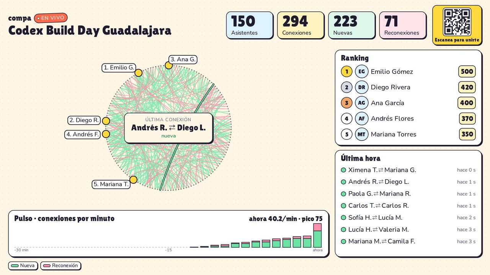
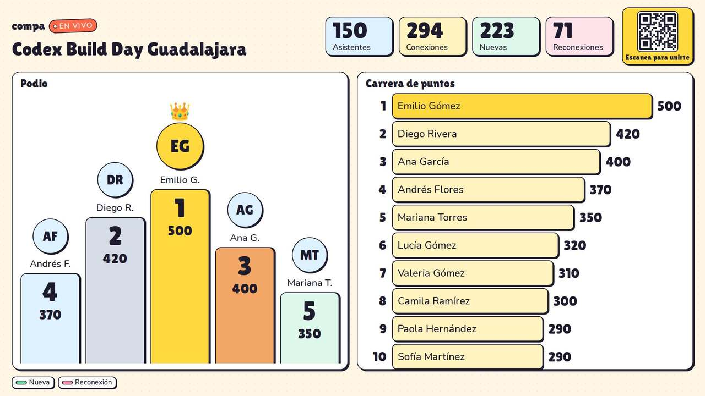
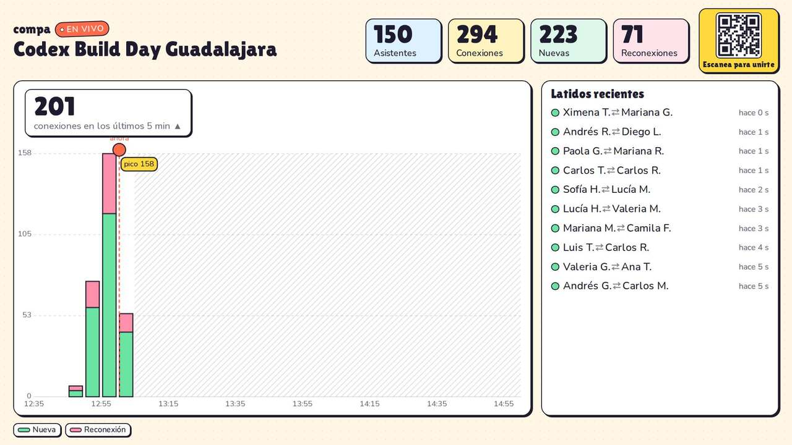
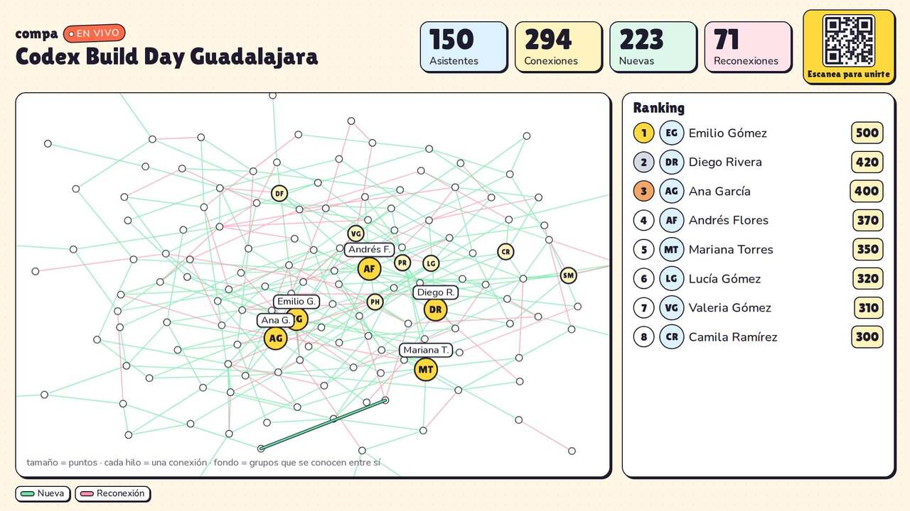
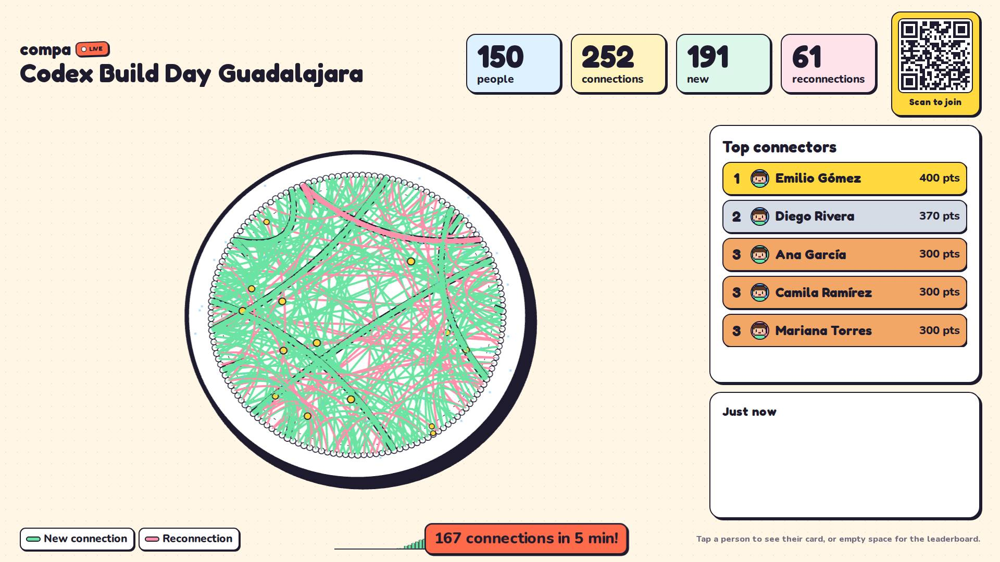
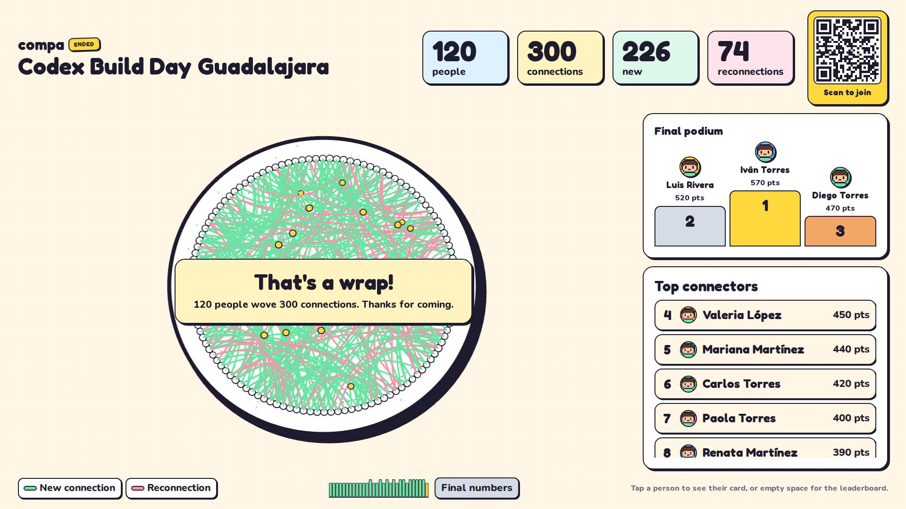
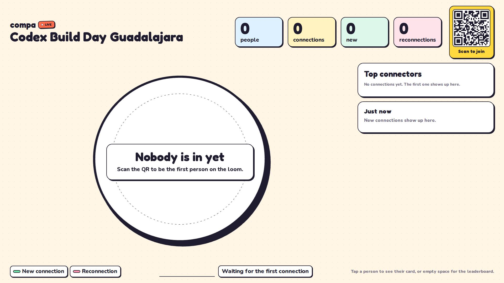

# Live board: the chosen visualization

Date: 2026-10-29 · Ticket: `COMPA-<TBD>` · Builds on [live-dataviz.md](live-dataviz.md) (research, PR #54) · Code: `components/live/`, `lib/live/live-model.ts`.

## Decision

**Loom+**: keep "El Telar" (the loom) as the hero and wrap it in a board that changes with the room. The research's
"director" shell is built in its simplest form: the mood comes from the snapshot alone (no dwell timer), and the
ranking, pulse, feed and finale are fixed slots, so nothing jumps around on a projector.

| Piece | What it shows | Source |
| --- | --- | --- |
| Loom | Every checked-in person a peg, every accepted connection a thread (mint new, bubblegum reconnection); new threads draw in thick and ink-outlined, then settle | `loom-scene.ts` |
| Pulse | Connections per minute for the last 30 min (current minute in sun) and a mood line: "12 in the last 5 min", "N connections in 5 min!" (rush), "Quiet moment: say hi to someone new" | `Pulse` in `LiveActivity.tsx` |
| Feed ("Just now") | The 4 newest pairs, "Ana ⇄ Luis", with "2 min ago"; names only, never what was said (p. 6, p. 13) | `Feed` |
| Ranking | Top 5 with photos; equal points and connections share a place (1, 1, 3) | `LeaderboardPanel` |
| State card | Over the loom: "Doors open at 7:00 PM" (upcoming), "Nobody is in yet" / "The loom is ready" (empty), "That's a wrap! 120 people wove 300 connections" (ended) | `StateCard` |
| Finale | After the close: final podium (1st in the middle, ties marked), then places 4–8; the pulse shows the event's last half hour, polling slows to 15 s | `Podium` |
| Reconnecting | "Reconnecting… data from N s ago" pill (or "The event code changed" after a rotation, from #63); failed polls time out at 8 s and back off 3 → 30 s; out-of-order snapshots are dropped and a stuck one reads as a failure; the tab coming back or the network returning polls at once | `useLiveSnapshot.ts` |

Moods (`moodOf`): `upcoming` and `ended` from the event phase; `empty` with no connection yet; `quiet` after 10 min
without one; `rush` at 12 or more connections in 5 min (or one per three people in the room); `steady` otherwise.

## Why this one

Four concepts were prototyped with the same scripted data and scored on legibility at 10 m, sense of momentum,
empty and ended states, scale, privacy, phone fit and reuse ([concepts/notes.md](live-dataviz/concepts/notes.md)):

| Concept | Score | Verdict |
| --- | --- | --- |
| **Loom+** (loom, pulse, feed, state cards) | 33 | **Chosen.** The only one where one glance says "something just happened", and it reuses the built loom, counters and ranking |
| Podium race | 33 | Best legibility and ending, but nothing moves between point changes and it ignores connections, the product's core action. Its final podium is borrowed for the ended state |
| Heartbeat (event histogram) | 28 | Clear trend, but a fixed event-window axis is an empty plot with a spike during a rush; its 1-minute strip became the pulse |
| Constellation (force graph) | 22 | A hairball at 150 people and a snowstorm at 2,500; the layout never settles |

This matches the research ranking ([dataviz-bigscreen/findings.md](dataviz-bigscreen/findings.md): director shell,
idle state, podium, finale, keep the loom).

| Loom+ | Podium race | Heartbeat | Constellation |
| --- | --- | --- | --- |
|  |  |  |  |

## Built for scale

- **Loom:** pegs are two instanced meshes (flat discs) and settled threads are merged into one mesh per kind
  (hairlines past 400 threads); at most 24 threads animate at once. Draw calls stay flat whatever the room size.
  2,500 people and 4,000 connections went from 0.2 fps to the software-renderer ceiling in headless Chromium; with
  reduced motion and nothing drawing, the loom stops rendering.
- **Snapshot:** carries at most the newest 1,000 connections (`LIVE_LINK_LIMIT`, also landed in #62); counters still count all. Each person
  now carries their connection count, so ties and ranks stay right when links are capped. The event's `phase`,
  `startsAt` and `endsAt` are in the snapshot (research DV-1, first part).
- **Order:** a snapshot older than the one on screen (a CDN serving a stale copy) never replaces it.

## Scenarios tested

`e2e/live/live-board.spec.ts` replays scripted frames from `lib/testing/live-scenarios.ts` into the board's poll
(mock mode, no database, no LinkedIn): zero, upcoming, one attendee, trickle, quiet, rush, ended, after the event,
ties, reconnects, long names, missing and expired photos, 2,500 people; network loss with backoff and recovery,
out-of-order snapshots, tab return, person card and its failure, reduced motion; and zero, rush, ended and long names
at 390, 834, 1440 and 1920 in `es` and `en` with no sideways scroll. Screens: [live-dataviz/screens/](live-dataviz/screens/).

| Rush | Ended | Zero |
| --- | --- | --- |
|  |  |  |

## Left for later

- Topic race (needs topics in the snapshot, DV-1/DV-5), a 600 px idle QR (DV-3), the 30 s mode dwell (DV-2),
  "=4" tie captions in the main ranking, an SVG fallback without WebGL, per-minute counts from the server when more
  than 1,000 connections land within 30 minutes.
- Colorblind safety: mint versus bubblegum is weak for deuteranopes; every color is labeled, and DESIGN.md already
  suggests sky for reconnections.
- Not verified on a real projector or phone GPU; fps numbers come from headless software rendering.

Related: [wiki/live-dashboard.md](../../wiki/live-dashboard.md), [DESIGN.md](../../DESIGN.md#big-screen-live).
