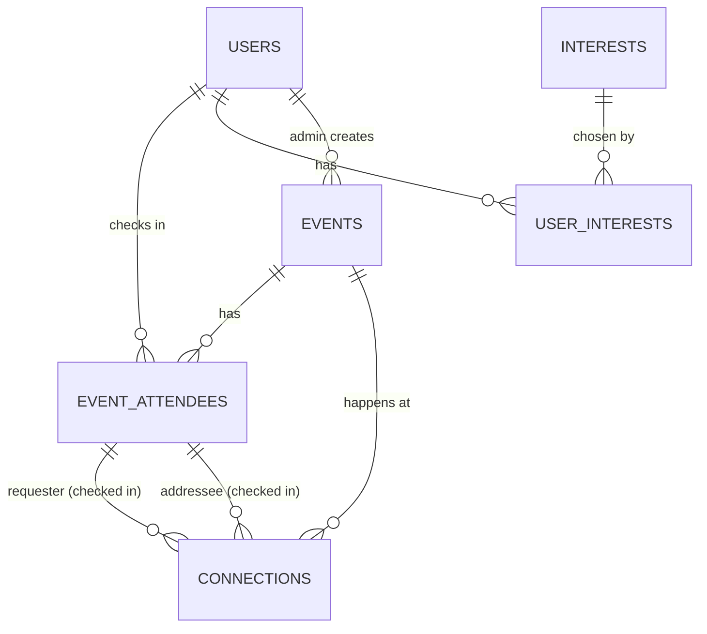

# COMPA data model spec

Ticket: `COMPA-<TBD>` · Date: 2026-10-29 · Status: approved by the captain in conversation (brainstorming session, 2026-10-28/29) · Supersedes: the data model in `docs/plans/2026-10-28-mvp-api-plan.md` §5 and §8, and the four-table model in `wiki/data-model.md` (p. 9–10).

Scope: database entities and the rules they enforce. API behavior: [`2026-10-29-api.md`](2026-10-29-api.md), which also adds `users.handle`.

## 1. Decisions

Every decision below was made by the captain in this session.

| # | Decision | Replaces |
| --- | --- | --- |
| M1 | COMPA spans **many events**. A person is one user across all of them. | Single-event model (p. 9) |
| M2 | **Sign-in is LinkedIn** (Supabase `linkedin_oidc`) **or an email magic link** (Supabase OTP, added 2026-10-29 at the team's request for people without LinkedIn). No handle + code, no passwords. Email users get `linkedin_sub` = their auth user id and the email's local part as name until they edit it. | "No login or OAuth" (AGENTS.md §4, ADR-007); handle + code (p. 4–5) |
| M3 | Points come **only from connections**: `new` = **20**, `reconnection` = **10**, to **both** people. | +10/+15 bridge/+5 first-of-day/+25 summary and the 12/h cap (p. 7) |
| M4 | A connection is **reconnection** if the pair has an accepted connection at an earlier event (automatic), **or** if either person declares "we already knew each other". History overrides; nobody can force `new` alone. | — |
| M5 | **One connection per pair per event**, regardless of who scanned whom. Meeting again at a later event creates a new connection (a reconnection). | One connection per pair forever (p. 9–10) |
| M6 | A connection needs **confirmation**: the scan creates a `pending` request; the scanned person accepts or declines. Points only on acceptance. | Instant connection (p. 5) |
| M7 | Either person may declare "we already knew each other": the requester when scanning, the addressee when accepting. | — |
| M8 | Pending requests **expire when the event ends**. A decline is **silent** (the requester keeps seeing "pending" until expiry) and the pair cannot connect again at that event. | — |
| M9 | People join an event by **checking in through the event QR**. Only checked-in attendees of the same event can connect. | Implicit single event |
| M10 | **Only COMPA admins create events** for now (`users.is_admin`). | — |
| M11 | Profile fields beyond LinkedIn: **headline**, **company**, **interests**, **social links**. No tribe. | Tribe, seeking, offering (p. 9) |
| M12 | Visibility per field and **per link**: `public`, `connections` (shown once you two have an accepted connection at any event), or `hidden`. **Name and photo are always public. Email is never shown.** | Leaderboard opt-out only (p. 13) |
| M13 | Everyone checked in **always appears on the big screen** with name and photo; check-in shows that notice and records consent. No anonymous mode. | "Anonymous" opt-out (p. 13) |
| M14 | Re-login **refreshes name and photo from LinkedIn unless the person edited that field** in COMPA. | — |
| M15 | Interests come from **one global table** we seed, shared by all events. | `lib/topics.ts` constant (p. 17) |
| M16 | On the big screen, **color encodes connection kind** (new vs reconnection); people are neutral. | Tribe colors |
| M17 | Bridges, rounds and badges are **out of the data model**. | Bridges (p. 7), P2 extras (p. 3) |
| M19 | **Events are reached only through an unguessable access code** in the event QR: `events.access_code`, 10 characters from a crypto RNG over `23456789abcdefghjkmnpqrstuvwxyz` (≈ 49 bits, `lib/access-code.ts`), generated on create, unique, rotatable by admins. The QR encodes `https://compa.lol/e/<access_code>`; the slug is for admins only. Migration `0003_event_access_code` backfills existing rows with 12 hex characters from `gen_random_uuid()` (captain decision, 2026-10-29). | Join link `/e/<slug>` |
| M18 | **AI summaries are back and score**: after a connection is accepted, either person drafts a summary (AI via `lib/ai`), edits and approves it; one approved summary per connection; **+25 to both** (constant `SUMMARY_POINTS`, value taken from `docs/contracts/ai-summaries-api.md`; captain to confirm). Summary text is never on the big screen. | M17 draft; p. 6, p. 18 |
| M20 | **Super admins, test people and event details** (captain decision, 2026-10-29). `users.role` (`user` \| `super_admin`, default `user`) replaces `is_admin`, which stays and mirrors it; migration `0005_super_admin_test_harness` backfills the three captains (`noe-camacho`, `iker-pindter-velasco`, `sebastian-gandoulf-perez`) and anyone already `is_admin`. `users.is_test` and `events.is_test` mark synthetic people and test events: a test user only joins a test event, and real events never count or show test users. Events gain `description`, `venue_name`, `address`, `city`, `country`, `website_url`, `timezone` (IANA, default `America/Mexico_City`), `schedule` (jsonb list of `{ date, start, end, title? }` in that zone) and `status` (`draft` \| `live` \| `ended` \| `archived`; only `live` runs, draft and archived open no public route). New `event_organizers (event_id, user_id, role owner\|organizer\|staff)`; `event_attendees.added_by` records an admin-assigned check-in. | M10 (`is_admin` only) |

## 2. Entities



| Entity | Purpose |
| --- | --- |
| `users` | One person, identified by their LinkedIn account; profile and visibility settings |
| `interests` | Global list of interests (seeded) |
| `user_interests` | Which interests a user picked |
| `events` | An event with an admin slug, a secret access code for its QR (M19) and a time window |
| `event_attendees` | Check-in of a user at an event, with big-screen consent |
| `connections` | A request between two checked-in attendees of one event, and its outcome |

## 3. SQL (Supabase Postgres)

```sql
create type connection_status as enum ('pending', 'accepted', 'declined', 'expired');
create type connection_kind   as enum ('new', 'reconnection');
create type visibility_level  as enum ('public', 'connections', 'hidden'); -- documents the allowed values used in users.visibility

create table users (
  id                 uuid primary key default gen_random_uuid(),
  auth_user_id       uuid not null unique references auth.users (id) on delete cascade,
  linkedin_sub       text not null unique,          -- LinkedIn's stable id (OIDC `sub`)
  handle             text not null unique check (handle ~ '^[a-z0-9-]{2,32}$'), -- personal QR /u/<handle> (API spec A8)
  email              text,                           -- account only; never shown (M12)
  name               text not null,                  -- always public (M12)
  photo_url          text,                           -- always public (M12)
  name_edited        boolean not null default false, -- true: re-login keeps the user's value (M14)
  photo_edited       boolean not null default false,
  headline           text check (char_length(headline) <= 120),
  company            text check (char_length(company) <= 80),
  links              jsonb not null default '{}',    -- {"linkedin": url, "github": url, "x": url, "instagram": url, "web": url}
  visibility         jsonb not null default '{
    "headline": "public", "company": "public", "interests": "public",
    "links": {"linkedin": "connections", "github": "connections", "x": "connections",
              "instagram": "connections", "web": "connections"}
  }',
  linkedin_raw       jsonb,                          -- last claims received from LinkedIn
  linkedin_synced_at timestamptz,
  is_admin           boolean not null default false, -- can create events (M10)
  created_at         timestamptz not null default now()
);

-- seeded from lib/topics.ts so profile interests and AI summary topics share one vocabulary (API spec §2)
create table interests (
  id   smallint generated always as identity primary key,
  slug text not null unique,                          -- 'ia', 'react', 'capital'
  name text not null                                  -- display label
);

create table user_interests (
  user_id     uuid not null references users (id) on delete cascade,
  interest_id smallint not null references interests (id),
  primary key (user_id, interest_id)
);

create table events (
  id         uuid primary key default gen_random_uuid(),
  slug       text not null unique,                    -- admin handle only (M19)
  access_code text not null unique check (access_code ~ '^[a-z0-9]{8,32}$'), -- event QR: /e/<access_code> (M19)
  name       text not null,
  starts_at  timestamptz not null,
  ends_at    timestamptz not null,
  created_by uuid not null references users (id),
  created_at timestamptz not null default now(),
  check (ends_at > starts_at)
);

create table event_attendees (
  event_id          uuid not null references events (id) on delete cascade,
  user_id           uuid not null references users (id) on delete cascade,
  checked_in_at     timestamptz not null default now(),
  screen_consent_at timestamptz not null,             -- saw "your name and photo will appear on the event screen" (M13)
  primary key (event_id, user_id)
);

create table connections (
  id             uuid primary key default gen_random_uuid(),
  event_id       uuid not null,
  requester_id   uuid not null,                       -- who scanned
  addressee_id   uuid not null,                       -- who confirms
  status         connection_status not null default 'pending',
  requester_knew boolean,                             -- "we already knew each other"; null = not answered (M7)
  addressee_knew boolean,
  kind           connection_kind,                     -- set on acceptance (M4)
  points         smallint,                            -- 20 or 10, set on acceptance (M3)
  created_at     timestamptz not null default now(),
  responded_at   timestamptz,
  check (requester_id <> addressee_id),
  -- both people must be checked in to this event (M9)
  foreign key (event_id, requester_id) references event_attendees (event_id, user_id) on delete cascade,
  foreign key (event_id, addressee_id) references event_attendees (event_id, user_id) on delete cascade,
  -- kind and points exist exactly when accepted, and points follow kind (M3)
  check ((status = 'accepted') = (kind is not null and points is not null)),
  check (kind is null or (kind = 'new' and points = 20) or (kind = 'reconnection' and points = 10))
);

-- one connection per pair per event, whatever the direction (M5, M8)
create unique index connections_pair_per_event_uq
  on connections (event_id, least(requester_id, addressee_id), greatest(requester_id, addressee_id));
create index connections_requester_idx on connections (requester_id);
create index connections_addressee_idx on connections (addressee_id);
create index connections_event_status_idx on connections (event_id, status);

create table interactions (                        -- AI summaries (M18)
  id            uuid primary key default gen_random_uuid(),
  connection_id uuid not null references connections (id) on delete cascade,
  author_id     uuid not null references users (id) on delete cascade,
  summary       text not null check (char_length(summary) <= 1200),
  topics        text[] not null default '{}',          -- from lib/topics.ts
  next_steps    text[] not null default '{}',
  substantive   boolean not null,
  fallback      boolean not null default false,        -- AI failed; summary is the author's text
  points        smallint,                              -- SUMMARY_POINTS, set on approval
  approved_at   timestamptz,
  created_at    timestamptz not null default now(),
  check ((approved_at is null) = (points is null))
);
create unique index interactions_one_approved_uq on interactions (connection_id) where approved_at is not null;

-- scores: derived, never stored separately (M3)
create view event_scores as
  with awards as (
    select c.event_id, p.user_id, c.points, 1 as is_connection
    from connections c cross join lateral (values (c.requester_id), (c.addressee_id)) as p (user_id)
    where c.status = 'accepted'
    union all
    select c.event_id, p.user_id, i.points, 0
    from interactions i join connections c on c.id = i.connection_id
    cross join lateral (values (c.requester_id), (c.addressee_id)) as p (user_id)
    where i.approved_at is not null
  )
  select event_id, user_id, sum(points)::int as points, sum(is_connection)::int as connections
  from awards group by event_id, user_id;

create view lifetime_scores as
  select user_id, sum(points)::int as points, sum(connections)::int as connections
  from event_scores
  group by user_id;
```

### 3.1 Amendment M20 (migration `0005_super_admin_test_harness`)

```sql
alter table users add column role text not null default 'user' check (role in ('user', 'super_admin'));
alter table users add column is_test boolean not null default false;        -- synthetic real-mode test person
alter table events add column description text check (char_length(description) <= 2000);
alter table events add column venue_name text check (char_length(venue_name) <= 120);
alter table events add column address text check (char_length(address) <= 200);
alter table events add column city text check (char_length(city) <= 80);
alter table events add column country text check (char_length(country) <= 80);
alter table events add column website_url text check (char_length(website_url) <= 500);
alter table events add column timezone text not null default 'America/Mexico_City'; -- IANA, validated in lib/events/schedule.ts
alter table events add column schedule jsonb not null default '[]';          -- [{ date: 'YYYY-MM-DD', start: 'HH:MM', end: 'HH:MM', title? }]
alter table events add column status text not null default 'live' check (status in ('draft', 'live', 'ended', 'archived'));
alter table events add column is_test boolean not null default false;
alter table event_attendees add column added_by uuid references users (id) on delete set null; -- admin-assigned consent
create table event_organizers (
  event_id   uuid not null references events (id) on delete cascade,
  user_id    uuid not null references users (id) on delete cascade,
  role       text not null default 'organizer' check (role in ('owner', 'organizer', 'staff')),
  created_at timestamptz not null default now(),
  primary key (event_id, user_id)
);
-- backfill
update users set role = 'super_admin' where handle in ('noe-camacho', 'iker-pindter-velasco', 'sebastian-gandoulf-perez') or is_admin;
update users set is_admin = true where role = 'super_admin';
update events set status = 'ended' where ends_at <= now();
```

## 4. Rules the data model enforces

### 4.1 Creating a request

Allowed only when all of these hold; the database enforces the starred ones:

- both users are checked in to the event (*composite foreign keys);
- they are different people (*check);
- the pair has no connection at this event in any status (*unique index), so a declined or expired pair cannot retry at that event (M8);
- the event has not ended (`now() < events.ends_at`; enforced in the API).

### 4.2 Accepting

1. Only the addressee accepts; the row must be `pending` and the event not ended.
2. Record `addressee_knew` (may be null).
3. Decide the kind:
   - `reconnection` when an **accepted** connection exists between the same two users at **another event that started earlier**, or when `requester_knew` or `addressee_knew` is true;
   - otherwise `new`.
4. Set `status = 'accepted'`, `kind`, `points` (20 or 10), `responded_at = now()` in one statement guarded by `where status = 'pending'`, so a double tap cannot accept twice.

### 4.3 Declining and expiry

- Decline sets `status = 'declined'`, `responded_at = now()`. The API shows it to the requester as `pending` until the event ends, then as `expired` (silent decline, M8).
- Expiry is **evaluated on read**: a `pending` row whose event has ended is treated as `expired`. A scheduled job may later persist `status = 'expired'`; correctness does not depend on it.

### 4.4 Scores

- Event leaderboard: `event_scores` filtered by event, ordered by `points` desc, then `connections` desc, then earliest check-in.
- Lifetime score: `lifetime_scores`.
- Both people of an accepted connection receive its points (confirmed by the captain).

### 4.5 Visibility

One server-side function builds every view of another person:

- always: `name`, `photo_url`;
- `headline`, `company`, `interests`, and each link: included when its level is `public`, or `connections` and the two users have an accepted connection at any event; never when `hidden`;
- never: `email`, `auth_user_id`, `linkedin_sub`, `linkedin_raw`, `is_admin`, `role`, `is_test`.

Hidden data is never sent to the client.

### 4.6 LinkedIn sync (M14)

On every sign-in: update `linkedin_raw` and `linkedin_synced_at`; update `name` unless `name_edited`; update `photo_url` unless `photo_edited`. Editing either field in COMPA sets its `_edited` flag.

### 4.6a Test people and lifecycle (M20)

- A test user (`is_test`) checks in only to a test event, whether by QR, scan or admin; anything else is `409 test_user_not_allowed`.
- At a real event, the door counters, live snapshot, person card and leaderboard leave test users and their connections out.
- `isRunning` is true only for `status = 'live'` inside the window; `ended` and `archived` count as over, so pending requests expire. "End now" sets `ends_at = now()` (keeping `ends_at > starts_at`).

### 4.7 Access

RLS is enabled on every table with no client policies; all reads and writes go through server route handlers with the service-role key (ADR-006, p. 11). What the big screen may receive (name, photo, points, connection kind; never email) is defined in the API spec.

## 5. Out of scope for this model

Bridges, rounds, badges, organizer self-service, event-specific interest lists, photo upload (photos come from LinkedIn; editing a photo needs an upload mechanism, see open question #16).

## 6. Open questions

Tracked in `wiki/open-questions.md` (#20 onward were added with this spec).

Related: `docs/plans/2026-10-28-mvp-api-plan.md` (earlier plan; its data model is superseded), `wiki/data-model.md`, `wiki/open-questions.md`.
